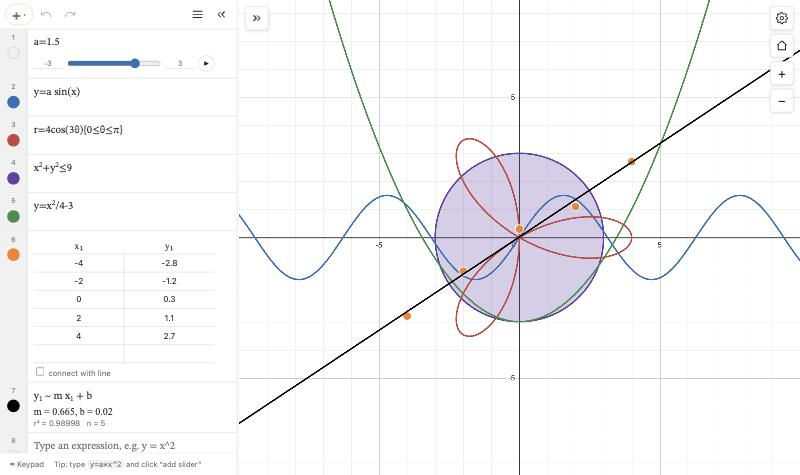
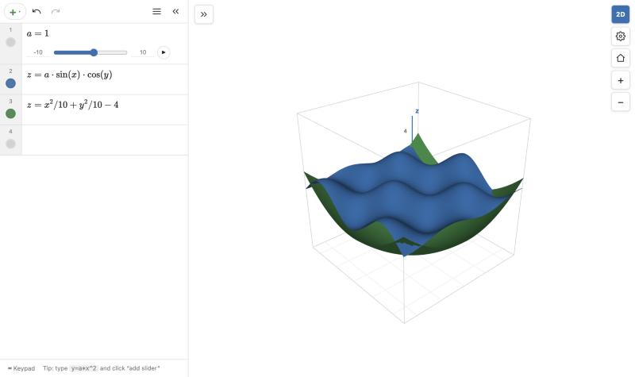
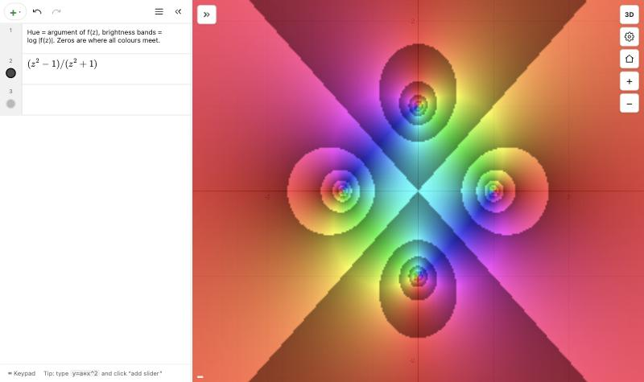
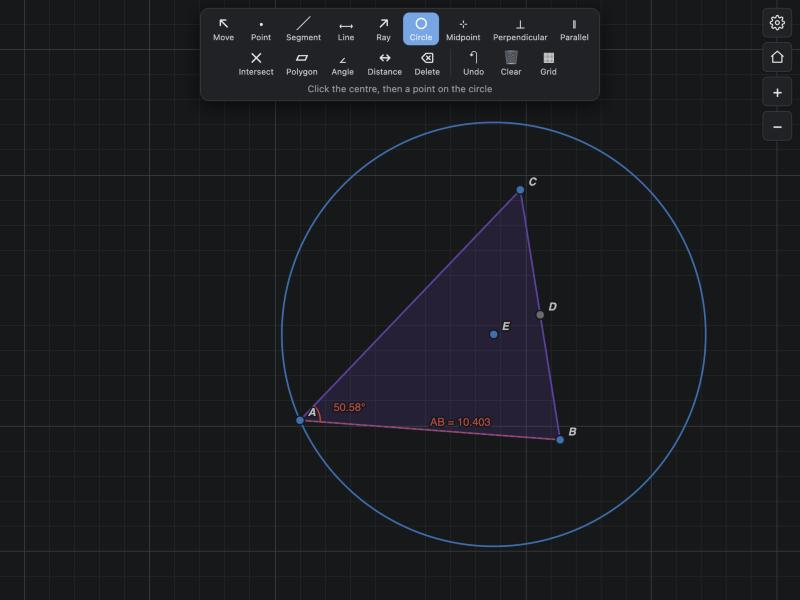
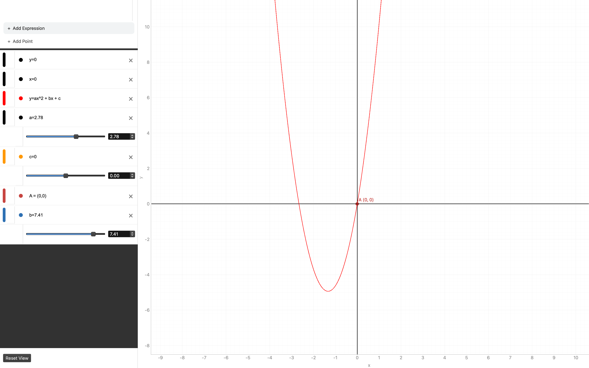

# 📈 Graphical Calculator

> A Desmos-style graphing calculator — runs **in your browser** with zero installs, plus a native Python desktop edition.

<p align="center">
  <a href="https://shivamhimatsingka.github.io/Graphical-Calculator/"><b>▶ Open the live web app</b></a>
</p>

<p align="center">
  
</p>

<p align="center">
  
  
</p>
<p align="center">
  
</p>

This repository contains two editions:

| Edition | Where | Stack | Best for |
| --- | --- | --- | --- |
| 🌐 **Web** (recommended) | [`docs/`](docs/) · [live site](https://shivamhimatsingka.github.io/Graphical-Calculator/) | Plain HTML / CSS / JavaScript (live formula editor via MathLive from a CDN, optional) | Everything — full Desmos-style feature set, works on desktop, tablet and phone |
| 🖥️ **Desktop** | [`desktop/`](desktop/) | Python, PySide6, PyQtGraph, NumPy, SymPy | The original native app (functions, sliders, points, tracing) |

---

## ✨ Web features

**Three calculators in one** (☰ menu → *Calculator*)

* **Graphing** — everything below
* **Geometry** — dynamic constructions: points, segments, lines, rays, circles, midpoints, perpendicular & parallel lines, intersections, polygons, angle and distance measurements; drag any free point and everything built on it follows; undo, delete (with dependants)
* **Scientific** — a full-screen scientific calculator: sin/cos/tan & inverses (2nd), logs, powers, roots, factorial, %, EXP, ANS, memory (MC/MR/M+/M−), DEG/RAD, complex and list results, history

**Graph anything**

* Functions `y = f(x)` and `x = f(y)`
* Polar `r = f(θ)` and parametric `(x(t), y(t))`
* Implicit curves, e.g. `x^2 + y^2 = 25`
* Inequalities with shading, including chains: `y < x^2`, `1 < x < 3`
* **Complex domain colouring**: type a function of `z` alone — `(z^2-1)/(z^2+1)`, `sin(z)`, `z^3-1` — and the plane is coloured by phase and magnitude
* **3D graphs** (press the **3D** button): surfaces `z = f(x,y)`, parametric curves `(x(t), y(t), z(t))`, parametric surfaces `(x(u,v), y(u,v), z(u,v))`, implicit surfaces `x^2+y^2+z^2=9`, 3D inequalities (translucent) `z<4-x^2-y^2`, 3D points you can drag (Shift = up/down); **tangent planes** (click a surface); drag to rotate, wheel/pinch to zoom, adjustable box, auto-rotate
* Points (drag them!) with optional labels, point lists, multi-column tables
* Piecewise functions `{x<0: -x, x^2}` and domain restrictions `y = x^2 {x > 0}`

**Live formula editor**

* Type naturally and see typeset maths as you go: `x^2` raises a superscript, `/` builds a fraction, `sqrt` becomes √, `pi` → π, `<=` → ≤ … (powered by [MathLive](https://mathlive.io), loaded from a CDN)
* Works with the on-screen keypad; falls back to a plain-text editor automatically if the CDN is unreachable (or switch under ⚙ → *Formula editor*)

**Math engine**

* Your own functions `f(x) = …`, derivatives `f'(x)`, numeric `int`, `sum`, `prod`, `nderiv`
* Implicit multiplication (`2x`, `a(x+1)`, `sin 2x`, `sin^2(x)`), `|abs|`, `n!`, `30°`, `log_2(x)`
* **Complex numbers**: `i`, `3+4i`, `(1+i)^2`, `e^(i*pi)`, `abs`, `arg`, `real`, `imag`, `conj`, and complex `sqrt/exp/ln/sin/cos…` — a complex value plots as a point
* Radians / degrees mode

**Sliders**

* Use any new letter and click **add slider** — adjustable range, step, speed, **play/animate**
* Two-way sync between the text (`a=2.5`) and the slider; play modes: loop, bounce, once

**Actions & ticker**

* `n -> n+1` (or `n → n+1`) makes a **Run** button; several at once with commas: `a -> a+1, b -> 0`. All right-hand sides are evaluated first, like Desmos
* **Ticker** repeats the action automatically (interval in the ⚙ menu)

**Lists & statistics**

* List comprehensions `[n^2 for n=[1...5]]`
* Lists `[1,2,3]`, ranges `[1...10]` / `[2,4...20]`, indexing `L[3]`, slicing `L[2...4]`, filtering `L[L>5]`
* Everything broadcasts: `L^2`, `sin(L)`, `f(L)`, `(L, L^2)`, and `y = L sin(x)` draws one curve per item
* `total mean median min max count stdev stdevp variance varp mad quartile corr cov sort unique join shuffle random`
* Statistics plots: `histogram(L, w)`, `boxplot(L)`, `dotplot(L)`, `barplot(L)`; also `mode`, `percentile`, `cumsum`, `diff`, `reverse`, `skewness`
* Distributions: `normpdf normcdf invnorm binompdf binomcdf poissonpdf poissoncdf exppdf expcdf unifpdf unifcdf`

**Tables & regression**

* Tables expose lists `x_1`, `y_1`, … ; add more columns (`+ column`) and rename them to use as lists
* Least-squares regression with **any model** (several restarts, so logistic / exponential fits converge), including several predictor lists, with RMSE: `y_1 ~ m x_1 + b`, `y_1 ~ a x_1^2 + b x_1 + c`, `y_1 ~ a*e^(b x_1)` — shows parameters, r² and residuals `e_1`

**Exploring the graph**

* Click a curve to see **zeros, extrema, y-intercept and intersections**; drag along it to trace
* **Tangent and secant lines** at the traced point (adjustable Δx), with their equations — and a one-click *Add line* to put them in your list
* Zoom (wheel / pinch), pan, scale a single axis by dragging along it, window settings, π-labelled axis
* Light / dark theme

**Workspace**

* Folders, drag-to-reorder rows, notes, colours, line styles and thickness, show/hide
* Undo / redo, on-screen keypad, autosave
* Save / open `.json`, export PNG, copy a share link, built-in examples

### Quick syntax reference

```text
y = a*sin(b*x + c)            sliders appear for a, b, c
r = 3cos(4θ) {0 <= θ <= 2π}   polar with a domain
(sin(3t), sin(2t)) {0<=t<=2π} parametric
x^2 + y^2 = 25                implicit
y < x^2 - 3                   inequality
f(x) = x^3 - 3x               define a function, then use f(2) or f'(x)
L = [1...10]                  list;  mean(L), L[L>5], (L, L^2)
y_1 ~ m x_1 + b               regression on table 1
int(0, 1, x^2)                integral;  sum(n,1,10,n^2) is a sum
z = 3 + 4i                    complex number (plots as a point);  abs(z), conj(z), e^(i*pi/3)
```

### Run it locally

The web app is static files — no build step.

```bash
python3 -m http.server 8000 --directory docs
# open http://localhost:8000
```

…or simply open `docs/index.html` in a browser. To self-host, publish the `docs/` folder anywhere (GitHub Pages: *Settings → Pages → `main` / `/docs`*).

### Run the tests

```bash
npm test                      # or: node tests/engine.test.js && node tests/latex.test.js   (Node 16+)
```

---

## 🖥️ Desktop edition (Python)

<p align="center">
  
</p>

Requires Python 3.10+ on macOS, Windows or Linux.

```bash
git clone https://github.com/ShivamHimatsingka/Graphical-Calculator.git
cd Graphical-Calculator
pip install -r desktop/requirements.txt
python desktop/main.py
```

Supports lines, polynomials, trigonometry, logarithms, exponentials, interactive sliders with two-way sync, custom colours, user-defined points, curve tracking, zoom/pan, show/hide/delete, and debounced live updates.

> The desktop edition has a smaller feature set than the web edition; new features land in the web app first.

---

## 📁 Project structure

```text
Graphical-Calculator/
├── docs/                    # 🌐 Web app (served by GitHub Pages)
│   ├── index.html
│   ├── css/style.css
│   └── js/
│       ├── mathengine.js    #   tokenizer, parser, list/stat runtime, code generator
│       ├── latex.js         #   LaTeX <-> text converters for the live formula editor
│       ├── graph.js         #   2D canvas renderer & interaction (marching squares, POIs, tracing, tangents, domain colouring)
│       ├── graph3d.js       #   3D renderer (projection, shaded meshes, marching tetrahedra, picking & dragging)
│       ├── geometry.js      #   geometry mode: constructions, intersections, measurements
│       ├── scientific.js    #   scientific calculator overlay
│       └── app.js           #   UI, evaluation pipeline, sliders, tables, folders, regression
├── desktop/                 # 🖥️ Python/PySide6 edition
│   ├── main.py
│   └── requirements.txt
├── tests/                   # engine, LaTeX converter and geometry tests
├── assets/                  # README images
├── package.json             # `npm start` / `npm test` helpers
├── LICENSE
└── README.md
```

### How the web app works

1. **Parse** — `mathengine.js` tokenizes and parses each row into an AST (implicit multiplication, lists, ranges, indexing, piecewise, restrictions).
2. **Classify** — `app.js` decides what each row is: slider, function definition, curve, point, inequality, regression…
3. **Compile** — the AST is compiled to a fast JavaScript closure; list-aware code is generated only where lists are involved.
4. **Render** — `graph.js` samples curves adaptively (discontinuity-aware), runs marching squares for implicit curves and inequalities, and draws on a HiDPI canvas.

---

## 🗺️ Status & roadmap

- [x] Derivatives, integrals, sums, products
- [x] Roots, extrema, intersections
- [x] Inequalities and filled regions
- [x] Parametric and polar equations
- [x] Lists, statistics and regression
- [x] Animated sliders with adjustable ranges
- [x] Undo / redo, save & load, image export, share links
- [x] Dark mode
- [x] Live formula editor
- [x] Complex numbers
- [x] Tangent / secant lines
- [x] Complex domain colouring
- [x] Actions / ticker
- [x] 3D graphs (surfaces, curves, parametric & implicit surfaces, points)
- [x] Histograms, box plots, dot plots; list comprehensions; multi-column tables
- [x] 3D inequalities, tangent planes and draggable 3D points
- [x] Geometry and scientific calculator modes
- [x] Bar plots, more statistics functions, robust multi-start regression
- [ ] Geometry: transformations (reflect / rotate / dilate), conics, angle bisectors, polygon area
- [ ] 3D: tangent planes for parametric/implicit surfaces, volume shading
- [x] Geometry constructions are saved in autosave, JSON files and share links

---

## 🐛 Troubleshooting

* **Web app shows an old version after an update** — hard-refresh (⇧⌘R / Ctrl+F5); browsers cache the JavaScript.
* **Row shows a red message** — hover/read it: it names the problem (unknown character, unmatched parenthesis, …).
* **`ModuleNotFoundError: No module named 'PySide6'`** (desktop) — `pip install -r desktop/requirements.txt`.

---

## 🤝 Contributing

Issues and pull requests are welcome.

1. Fork the repo and create a branch.
2. For the web app, edit files in `docs/` and run `npm test`.
3. Open a pull request describing the change.

When reporting a bug please include your OS/browser (or Python version), the exact expression, what you expected and what happened — a screenshot helps.

---

## 📄 License

MIT — see [`LICENSE`](LICENSE).

## 👨‍💻 Author

**Shivam Himatsingka**

<p align="center">⭐ If you like this project, consider giving it a star!</p>
